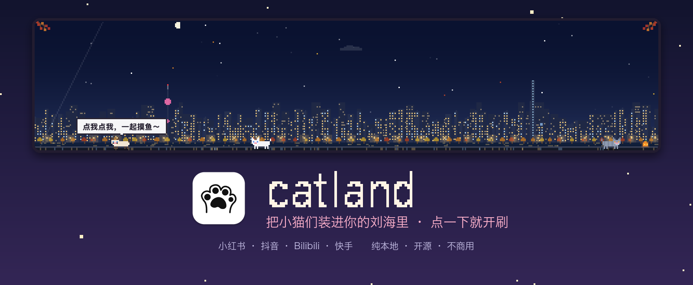
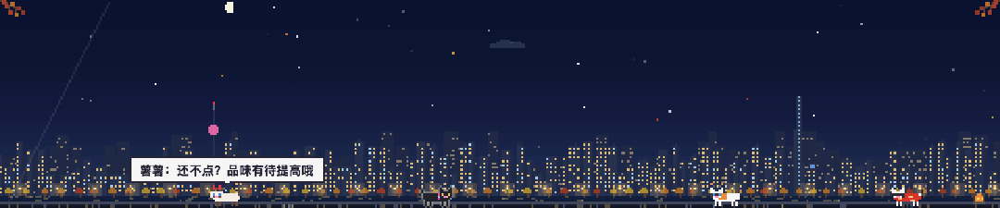
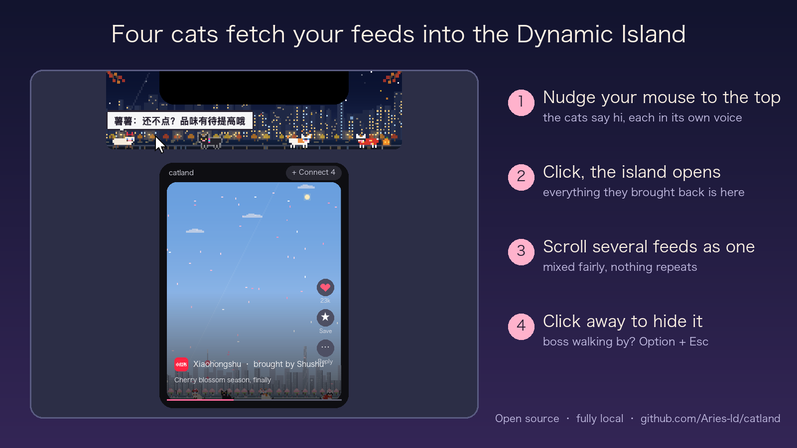
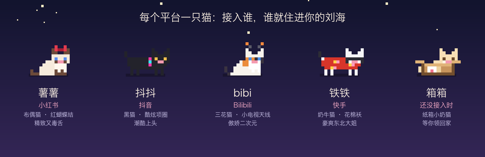
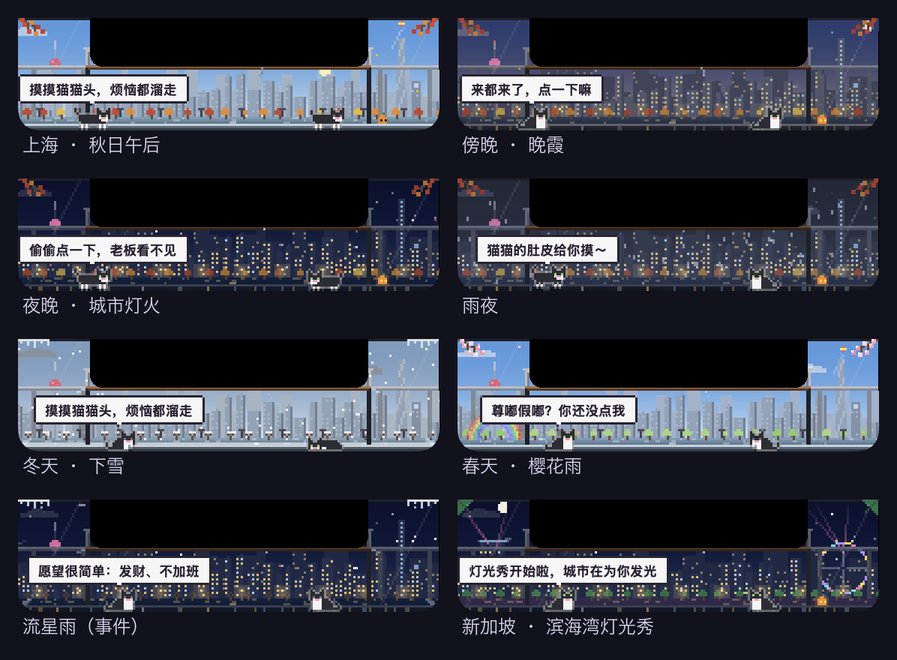

<div align="center">



<br>

### Four cats live in your Dynamic Island

They go out to Xiaohongshu, Douyin, Bilibili and Kuaishou, and bring back what you like to watch.<br>
When you need a break, click them.

<br>

[](#install)
[](LICENSE)
[](#what-is-on-the-island-stays-on-your-mac)
[](https://github.com/cv-cat/catbus)

[中文](README.md) · [Install](#install) · [The cats](#four-cats-and-one-still-waiting) · [Build from source](#build-from-source)

</div>

<br>

I keep four cats in my MacBook's Dynamic Island.

They live on a tiny island called catland, right next to the camera at the top of the screen. The island runs on my time: when it gets dark here, its windows light up one by one; when it rains here, it rains outside its window too.

Every day the cats go out. Shushu goes to Xiaohongshu, Doudou to Douyin, Bibi to Bilibili, Tietie to Kuaishou. They bring back the things I like to watch and leave them on the island for me.

While a build is running, while someone else is still talking in a meeting, in the ten minutes left after lunch, I nudge my mouse to the top of the screen and click them. What they brought back opens up and I scroll through it. When I'm done, I click somewhere else and the island folds away, as if nothing happened.

You can keep a few too.

<div align="center">

</div>

## What it does

<div align="center">

</div>

catland is a small macOS app that lives around the notch. Click it and you get one vertical feed mixing the recommendations from the platforms you've connected: videos, photo posts and comments, with the feel of a short-video app. Likes and saves are kept locally. Nothing is posted back to the platforms.

## Four cats, and one still waiting

<div align="center">

</div>

Each cat looks after one platform. Connect a platform and its cat moves onto the island.

- **Shushu**, a ragdoll with a red bow, goes to Xiaohongshu. Elegant and a little mean, but she'll still bring you the good stuff first.
- **Doudou**, a black cat with a glowing collar, goes to Douyin. Knows every meme, hums every soundtrack.
- **Bibi**, a calico with two little TV antennas, goes to Bilibili. Tsundere, stays up late watching anime.
- **Tietie**, a cow-pattern cat in a flowery northeastern quilted jacket, goes to Kuaishou. Loud, warm-hearted, protective.

When you first open catland, there's only **Xiangxiang**, a kitten peeking out of a cardboard box, waiting for you to bring the others home. The day the first cat arrives, she does a little happy hop.

Cats can't always go out. If a platform rate-limits a cat, it curls up for a nap with a little zzz and goes out again when it wakes. If its key expires (the login), it stays off the island for now. One glance at the island tells you who's out working for you today.

## Same sky as yours

<div align="center">

</div>

The view outside isn't a wallpaper. Sunset times and weather follow your city, using macOS location (not your IP, so a VPN won't move you to another country). Beijing, Shanghai and Singapore have their own skylines; other cities get Beijing's or Shanghai's, with your own sky and weather. Seasons change the trees, holidays bring lanterns and moons, and on real meteor shower nights the cats tell you a few hours ahead, then sit together and watch.

## What is on the island stays on your Mac

No server, no account, no analytics. Your likes and saves live only on your computer and never go back to the platforms. Platform logins are stored locally in `~/.catbus/`. The only outside request besides the platforms you connect is the weather, which sends coordinates rounded to about 10 km; you can turn it off.

## Install

1. Download `catland-x.y.z-macos-arm64.dmg` (Apple silicon) from [Releases](https://github.com/Aries-ld/catland/releases/latest). Intel Macs: [build from source](#build-from-source).
2. Open the DMG and drag catland into Applications. It's signed and notarized, so it opens with a double-click.
3. Xiangxiang appears at the top of your screen. Click her, choose Connect, and bring your first cat home (QR code for Xiaohongshu, Bilibili and Kuaishou; the official Douyin page for Douyin).

Requires macOS 14 or later. Everything it needs is bundled.

| Action | How |
|---|---|
| Open / hide the island | Click, or `⌥ \`` |
| Boss walking by | `⌥ Esc` hides and pauses instantly |
| Next / previous | Trackpad swipe, scroll wheel, `↑` `↓`, `J` `K` |
| Like / save / comments | Double-click, or `L` / `S` / `C` |

The platforms available today are Chinese content platforms. Weibo, X and TikTok aren't open yet (see the Chinese README for why).

## Build from source

```bash
brew install node xcodegen             # Node 26+
git clone https://github.com/Aries-ld/catland.git && cd catland
(cd apps/sidecar && npm install)
apps/macos/scripts/run.sh              # run the dev build
scripts/package-dmg.sh                 # or package a DMG into dist/
```

## Notes

- catland is a personal open-source project for learning and research, not for commercial use. Content comes from the platforms' public web interfaces via [catbus](https://github.com/cv-cat/catbus); please respect their terms and don't hammer them.
- Platform names and icons belong to their owners and are only used to label where content comes from.
- catland never likes, comments, follows or posts anything on your behalf.

## Thanks

[catbus](https://github.com/cv-cat/catbus) by [cv-cat](https://github.com/cv-cat): a cat bus that carries the cats of every platform. catland is the island where they get off.

<div align="center"><sub>MIT License</sub></div>
